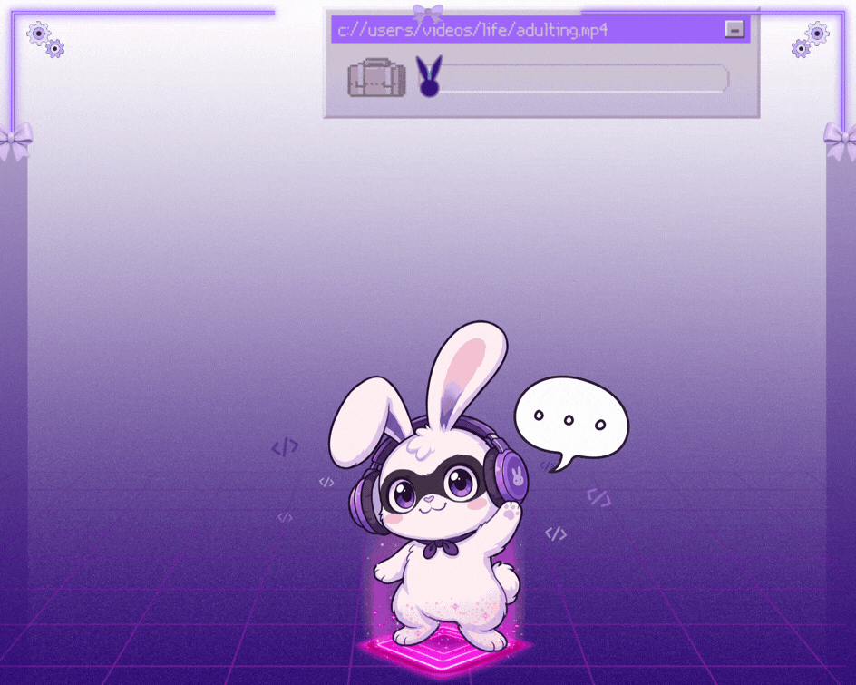
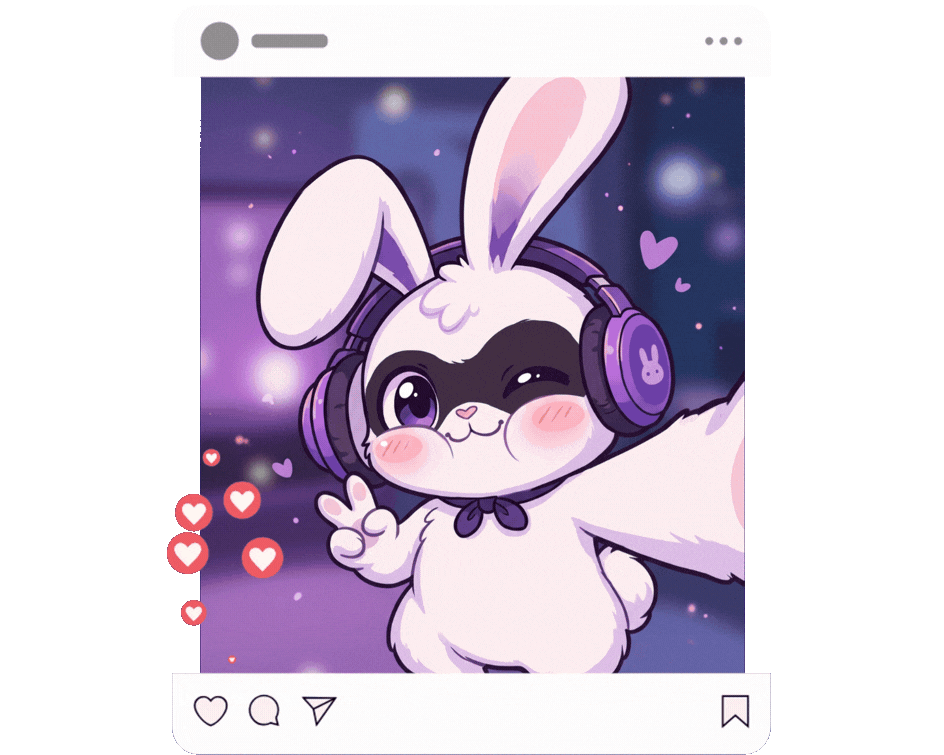

[+ao+meu+perfil!)](https://git.io/typing-svg)

# Oiê! Eu sou a Nicole 💜

Sou estudante de Engenharia de Software e gosto de transformar ideias em soluções digitais, unindo desenvolvimento, criatividade e tecnologia.

###   🐰 Minhas áreas de interesse:

- 💻 Desenvolvimento Front-end
- ☁️ Computação em Nuvem
- 🎨 UI/UX Design
- 🤖 Dados e Inteligência Artificial

  <!-- HEADER ANIMADO -->
  

> 🐰 **Floquinho:** Está curiosa(o) pra saber quem sou?

 

<!-- SEÇÃO DE TECNOLOGIAS -->

  <h2>💜 Minha caixa de ferramentas</h2>

  
 Tecnologias que utilizo para transformar ideias em projetos.

   

  <h3>🎨 Front-end & Design</h3>
  

    

  <h3>☁️ Back-end, Cloud & Banco de Dados</h3>

  

    

  <h3>📊 Dados & Visualização</h3>

  

  

    

  <h3>🛠️ Versionamento & Colaboração</h3>

  

 

 > 🐰 **Floquinho:** Desenvolvendo, experimentando e aprendendo...

<!-- FIM DA SEÇÃO DE TECNOLOGIAS -->

<!-- PAUSA PARA O FLOQUINHO -->

 

  <h2>🌙 O laboratório está em pausa...</h2>

  

    Os experimentos de hoje foram concluídos.
    O cientista responsável está indisponível no momento.
  

   

  

    <em>
      💤 "Só vou fechar os olhos por cinco minutinhos..."
    </em>
  

  
    Sistema em modo de descanso · Retornaremos após o café. ☕
  

 
<!-- FIM DA PAUSA -->
 

 🌐 Onde me encontrar:   
 
  
 

   
 

 
  
